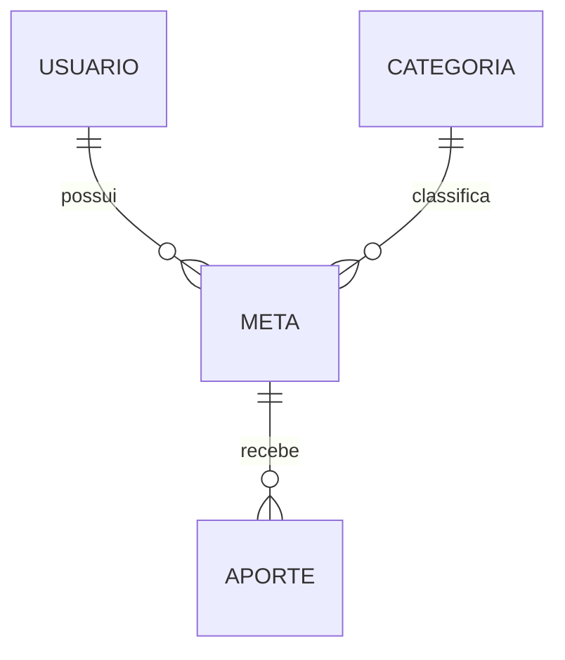

# MetaFin - Gestão de Metas Financeiras

> Projeto acadêmico de fintech voltado ao acompanhamento de metas financeiras pessoais.

## Visão geral

O MetaFin permite cadastrar metas financeiras, acompanhar seu progresso, registrar aportes e consultar informações da meta. A solução foi trabalhada sob as óticas de requisitos, prototipação de interface e modelagem de banco de dados.

## Escopo demonstrado

- Gestão/listagem de metas e visão geral do progresso.
- Criação de meta, registro de aporte, detalhes e edição da meta.
- Épico de Gestão de Metas Financeiras e cinco user stories com critérios de aceite.
- Modelos lógico e relacional/físico com quatro entidades: `USUARIO`, `CATEGORIA`, `META`, `APORTE`.

## Dados e relacionamentos

O e-mail de usuário e o nome da categoria são únicos; cada meta possui seu identificador e referências ao usuário e à categoria; aportes referenciam apenas a meta para evitar redundância. O valor acumulado pode ser calculado pelos aportes.

## Tecnologias e ferramentas

Figma, Oracle SQL Developer Data Modeler, lógica de modelagem relacional e SQL Oracle como referência física.

## Documentos

- [Modelo lógico](docs/modelo-logico.pdf)
- [Modelo relacional/físico](docs/modelo-fisico.pdf)
- [Requisitos resumidos](docs/requisitos.md)

## Estado

A documentação, os protótipos e os modelos foram produzidos em contexto acadêmico. Este repositório **não afirma conter um aplicativo implementado nem código de produção**.
